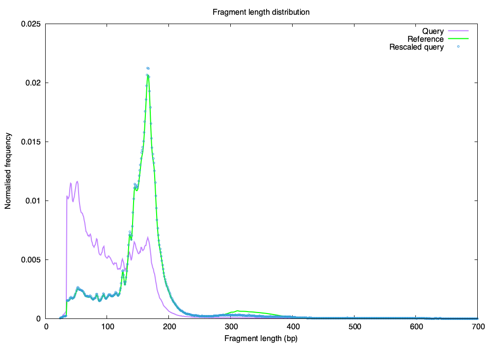

# Project 2: Rescale to Reference

Samples reads from a query BED file so that its fragment length distribution
matches a reference distribution.

## Files

- `run.sh`: runs the whole pipeline (run this)
- `hist.py`: makes a fragment length histogram from a BED file
- `rescale.py`: samples reads from the query to match the reference
- `plot.gp`: Gnuplot script that plots query, reference and rescaled query

## Input

- `query.bed.gz`: query fragments (chr, start, end, ...)
- `reference.hist`: reference distribution (length, normalised frequency)

## How to run

Put `query.bed.gz` and `reference.hist` in this folder, then:

```bash
chmod +x run.sh
./run.sh
```

## Output

- `query.hist`: query histogram (length, count, frequency)
- `query.rescaled.bed.gz`: the sampled reads (the rescaled query)
- `query.rescaled.hist`: histogram of the rescaled query
- `fragment_length_distributions.png`: plot of all three distributions

## How it works

1. `hist.py` counts how many query reads there are at each fragment length (length = end - start).
2. For each length L, we want the number of kept reads to be `K × reference(L)`, so the kept reads have the same shape as the reference.
3. Each read of length L is kept with probability `K × reference(L) / query_count(L)` (at most 1).
4. `K` is chosen as large as possible while every common length (reference frequency ≥ 0.1%) still has enough query reads, so the main peaks match exactly.
5. At rare lengths the query may not have enough reads; there all reads are kept, so a few points can fall below the reference (for example between 300 and 400 bp).
6. A fixed random seed makes the result the same every time.

## Result



## Requirements

Python 3 (no extra packages), gzip, Gnuplot.
